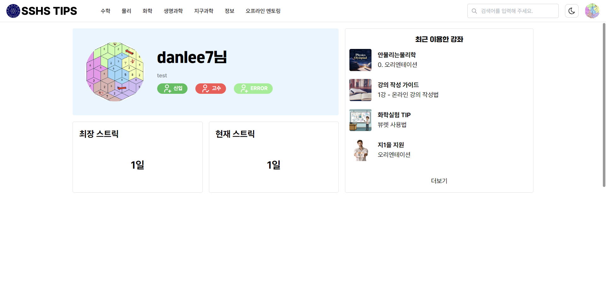
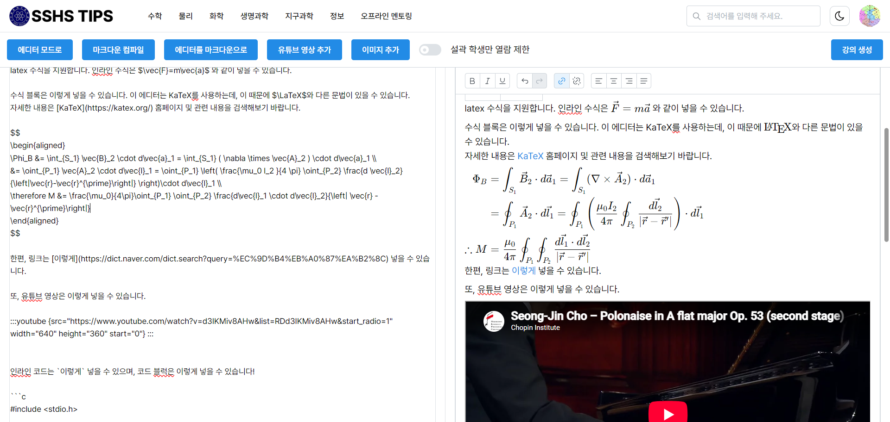
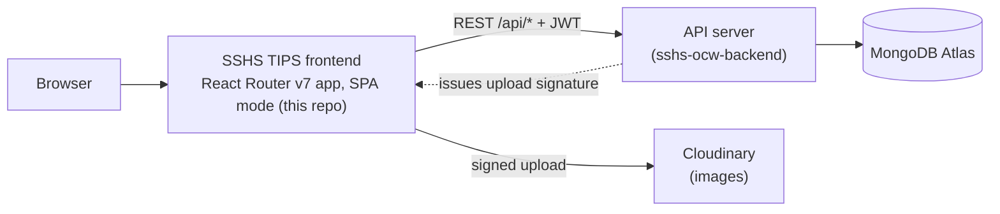

# SSHS TIPS — Seoul Science High School Open CourseWare

Students write lessons, teachers certify the best ones, and anyone at SSHS can study them for free.

Backend: [sshs-ocw-backend-mirror](https://github.com/danlee0677/sshs-ocw-backend-mirror)

Demo: https://tips.sshs.app/

Built for the SSHS Student Council, shared with permission

<p align="center">
  
  
</p>
<p align="center"><em>Left: home dashboard with study streak and badges. Right: the lesson editor with LaTeX math and a live Markdown toggle.</em></p>

## Summary
- **What:** A web platform where Seoul Science High School students publish course material for each other, organised into subjects and lessons, with a teacher-certification badge that marks trusted content.
- **Impact:** 270+ users, 9 subjects, 40 lessons, 20 mentorings
- **My role:** Lead developer of SSHS TIPS. I designed the architecture of both the frontend and the backend, and wrote 101 of the 146 frontend commits and 57 of the 68 backend commits. In this repo I built the React Router v7 migration, the lesson editor, the token-refresh client, the permissions UI, search, the mentoring board and the six-phase responsive redesign. Teammates contributed likes, achievement badges(under implementation), profile and home-page design, and the login-page restyle.

## Architecture



The frontend is a React Router v7 framework-mode app built in SPA mode (`ssr: false`). It ships as static files with a prerendered shell, and every page loads its data in the browser from the backend REST API. Images go straight from the browser to Cloudinary, using a short-lived signature issued by the backend, so the API server never handles image files.

## Stack
| Layer | Technology | Why this choice |
|---|---|---|
| Framework | React Router v7 (framework mode, SPA) on React 19, TypeScript 5.9 | Route modules give each page its own loader, error boundary and code-split bundle; SPA mode means static hosting with no Node server |
| Routing / data | Config-based route table ([src/routes.ts](src/routes.ts)), `clientLoader`, `/action/*` form routes, `useFetcher` | Data loading and mutations follow one pattern instead of ad-hoc `useEffect` fetching |
| Validation | Zod 4 | Every API response is parsed at the boundary, so backend changes fail loudly instead of silently |
| UI / styling | Mantine v8, CSS Modules | Accessible components, built-in dark mode, scoped styles per component |
| Rich text | TipTap 3 (KaTeX, tables, code, YouTube) | Science lessons need real math typesetting, not plain text |
| HTTP | Axios with interceptors | Central place for auth headers and token refresh |
| Build | Vite 7 via `@react-router/dev` (`react-router build`), ESLint | Fast dev server; `tsc -b` type-checks every build |

## How it works

### Lesson authoring
Lessons are written in a TipTap rich-text editor that supports LaTeX math, tables, syntax-highlighted code, collapsible sections and YouTube embeds. Authors can switch to raw Markdown and back at any time. Drafts (content, Markdown and metadata) are autosaved to `localStorage` with a debounce, so a closed tab or a dropped connection does not lose work. Lessons inside a subject can be reordered by drag and drop (dnd-kit).

### Trust & permissions
There is no single gatekeeper. Trust is layered instead:
- **Per-subject roles.** The creator of a subject becomes its `owner` (admins excepted) and can invite `editor`s, who can edit the subject and its lessons. Inviting and removing editors and transferring ownership happen on the subject's Access page, which only the owner or an admin can use.
- **Teacher certification.** Admins can mark a subject `teacher_certified`. It then shows a badge, and search can filter to certified subjects only.
- **Student-only lessons.** A lesson can be restricted to SSHS students (school e-mail); the subject's owner, editors and admins can also see it. Everyone else sees a notice that some lessons are hidden, rather than a silently shorter list.

### Auth and roles in the UI
| Role | What they see |
|---|---|
| Visitor | Landing page and sign-in |
| Signed-in user | Subjects, lessons, search, profile, streaks, badges, likes, mentoring board |
| SSHS student (school e-mail) | Plus student-only lessons (also visible to a subject's owner/editors and admins) |
| Creator | Plus "create subject" / "create mentoring" actions |
| Subject owner | Edit the subject and its lessons, manage editors, transfer ownership |
| Subject editor | Edit the subject and its lessons |
| Admin | Everything, plus role management and teacher certification |

Access tokens live in memory only. A refresh token sits in an httpOnly cookie. When any request returns 401, the Axios interceptor refreshes once and retries. Concurrent 401s share a single refresh request, and stale responses are detected by stamping each request with the token it was sent with ([src/libs/http.ts](src/libs/http.ts)).

### Responsive layout
The site was redesigned for phones in six phases (Phase 0–5, August 2026). The breakpoints are Mantine's (`sm` 48em, `md` 62em, `lg` 75em), defined in [src/libs/styles.ts](src/libs/styles.ts) for TypeScript and the theme, and mirrored in `postcss.config.cjs` for the CSS modules. Layout switches use CSS (`visibleFrom`/`hiddenFrom`) wherever possible, so the page is correct before any JavaScript runs. Interactive controls keep a 44px minimum tap target, and touch-specific behaviour is gated on `pointer: coarse` rather than screen width.

### Engagement
A GitHub-style study-streak heatmap, achievement badges and subject likes (updated optimistically, so they respond instantly) give students a reason to come back.

### Mentoring
A board for offline (in-person) mentoring sessions. Creators post sessions with the same rich-text editor. Each post has an owner who can transfer ownership and remove editors, using the same permission records as subjects.

## Technical highlights
- Migrated the app from a plain Vite + React SPA to React Router v7 framework mode (from Feb 2026), moving data fetching into route loaders.
- 29 route modules declared in one route config; every loader validates its API response with a Zod schema.
- Single-flight token refresh: N simultaneous 401s trigger 1 refresh call, not N.
- Drafts survive reloads: 3 separate autosaved stores (rich text, Markdown, metadata).
- A 6-phase responsive redesign with one set of breakpoints, declared in TS and mirrored in the PostCSS config.
- Signed direct-to-Cloudinary image uploads keep file traffic off the API server.
- Accessibility-minded details: 44px touch targets and hidden-content notices instead of silent omission.

## Project structure
```
src/
├── routes/          # one folder per feature; action.*.ts files are form-only routes
│   ├── lesson/      # create / edit / view lessons
│   ├── subject/     # subject pages + access (permissions) management
│   ├── mentoring/   # mentoring board
│   ├── home/        # dashboard, progress, badges
│   ├── search/      # filtered search
│   ├── admin/       # role management
│   └── auth/ startpage/ mypage/ settings/ catchall/
├── components/      # shared UI: editors, app shell, streak heatmap, badges
├── libs/            # http client, Zod schemas & types, breakpoints, hooks
├── styles/          # global / editor CSS
├── root.tsx         # loads the current user once and provides it to all routes
└── routes.ts        # route table
```

---
## Appendix

### Running locally
Requires Node 20.19+ (Vite 7) and a running copy of the backend.

```bash
npm install
echo 'VITE_API_URL="http://localhost:3001"' > .env   # backend URL
npm run dev                                          # http://localhost:3000
```

The dev-server port is set in `vite.config.ts` (`server.port`).

### Credits
Built with the SSHS Student Council development team.
- **danlee0677**: Lead developer. Architecture, React Router v7 migration, lesson editor, auth/token-refresh client, permissions and admin UI, search, profile history, mentoring board, streak heatmap, responsive redesign.
- **gdquail**: Frontend and UI design. Subject like button, achievement badges, first profile page, home page and floating action button, design passes on the app shell, subject, search and profile pages, YouTube toggle in the editor.
- **Sneatzy**: Mentor-recruitment link and button in the main navigation.
- **Seongjae Bae**: Login page redesign.
- **edward0613**: Navigation bug fix.
- **JH-dev1125**: Favicon.
